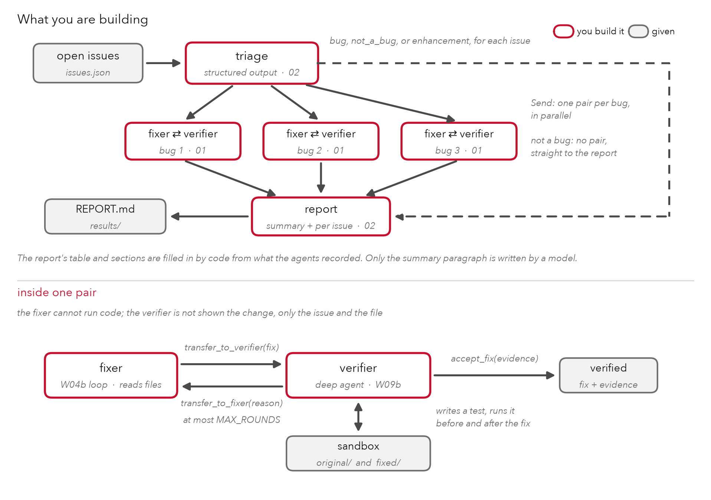

# DADA3: A Bug-Fixing Team for a GitHub Repository

Every software team keeps a list of open issues: reports from people who use the code, saying that something does not work the way they expected. Working through that list is ordinary, steady work. For each issue, someone has to decide whether it is a real bug, fix the code if it is, check that the fix works, and tell the maintainer what was done. Coding agents now do a growing share of this work, and the hard part is not writing a fix. It is knowing whether the fix is right.

In this assignment you will build a team of agents that works through the open issues of a small Python repository and writes a report for its maintainer. One agent in the team is a deep agent that runs code in a sandbox, as in W09b.2, and checks every fix before the report calls it verified. Then you will measure whether the team does better than one deep agent doing the whole job alone, using tests that neither of them has seen.

## 1. The repository

`huskyutils` is a small library of helper functions used in the Husky Tech store from earlier assignments: shipping prices, splitting a payment, delivery dates, slugs and descriptions for product pages, and a median for the sales dashboard. It is in `repo/` in this bundle. It is pure Python, so it runs in a sandbox with no network and nothing to install.

Each function's docstring is its specification. The repository's README says so: if the code and the docstring disagree, the code is wrong.

The repository has ten open issues, in `issues.json`, in the shape GitHub's API returns them. Seven are real bugs. The other three are not: two report behavior that the docstring promises, and one asks for a new feature. The repository's own tests all pass, which is typical: the bugs are in the cases nobody tested.

## 2. The system



1. **Triage** reads every issue and the library's code, and labels each issue as a bug, not a bug, or an enhancement. It makes one structured-output call per issue, like the reviewer's decision in W07b.
2. **One pair per bug.** Each issue labeled a bug goes, with `Send`, to its own fixer-verifier pair, and the pairs run in parallel, as the workers did in W07a.2.
3. **The fixer** reads the repository and writes a fix, but it cannot run code. It is the W04b loop, with three tools. When the fix is ready, it calls `transfer_to_verifier` with the changed file and a note.
4. **The verifier** is a deep agent whose backend is a sandbox, as in W09b.2. It gets two copies of the repository, before and after the fix. It is told which file changed but is not shown the change. It writes its own test from the issue and the docstring, runs it in both copies, and ends with one of two handoffs: `accept_fix` with its evidence, or `transfer_to_fixer` with the failing test and its output. The fixer reads that reason and tries again, up to `MAX_ROUNDS` times.
5. **The report** brings the pairs' results together for the maintainer. Code writes most of it from what the agents recorded: a table, and one section per issue with the diff, the verifier's evidence, and its test. A model writes only the summary paragraph at the top.

### Why this is a team of agents

You could give one deep agent the whole list and ask it to fix and check everything. The baseline in notebook 03 does exactly that. There are three reasons the work is split here.

- **A check is more useful when it is made by an agent that did not write what it is checking.** An agent that checks its own fix tends to test what it built rather than what was asked for. The verifier never sees the fix, only the issue and the docstring, so its test has to come from them.
- **The handoff carries information.** When a fix fails, the verifier does not just say no. It sends the failing test and its output, which is exactly what the fixer needs for its next attempt. You will see this happen, and in notebook 03 you will count when it helped.
- **Each pair has its own context and its own sandbox.** A pair works on one bug with only that bug's conversation, and its verification runs in a fresh sandbox, so that nothing from one fix can leak into another. This is also what lets the pairs run in parallel.

Whether the split is worth what it costs is the question your experiment answers. It costs a good deal more model calls than the baseline.

## 3. What you will do

| Notebook | What you build | Points |
|---|---|---|
| `DADA3_00_Start_Here` | setup, the repository and its issues, running the tests in a sandbox by hand | 0 |
| `DADA3_01_Fixer_and_Verifier` | the fixer's tools and loop, the verifier's handoffs, one verification, the pair's routing | 8 |
| `DADA3_02_Team` | triage, the fan-out, the report's summary, the graph, a full run, and the deployed app | 9 |
| `DADA3_03_Experiment` | the team against the baseline (given), and the write-up | 3 |

As in DADA2, write the code in the notebooks first. When a function works, move it into the matching file under `bugteam/`. Later notebooks and `app.py` import from `bugteam/`, so if a notebook fails because a module function is still empty, you skipped that step.

### The app

`app.py` serves your team through `bugteam_ui.py`, which is given. You pick an open issue, or write one of your own, and press **Fix**; the app shows triage's label, the fixer and the verifier handing the fix back and forth as it happens, and the report for that issue when the run finishes. You will deploy it on Render, as you did in DADA2, with the sandboxes on Daytona.

```
DADA3_00_Start_Here.ipynb ... DADA3_03_Experiment.ipynb
bugteam/
  config.py         settings and the chat model. Given.
  util.py           retry, text_of, CallCounter. Given.
  repo.py           the repository and the issues. Given.
  sandbox.py        open_sandbox and the file helpers from W09b.2. Given.
  docker_sandbox.py the Docker sandbox from W09b.2. Given.
  fixer.py          notebook 01: two tools and after_tools
  verifier.py       notebook 01: the handoffs, decision, and verify
  pair.py           notebook 01: after_fixer and after_verifier
  team.py           notebook 02: triage, fan_out, summary, build_graph
  baseline.py       the single deep agent. Given.
  evaluate.py       scoring with the hidden tests. Given.
repo/               huskyutils and its tests
issues.json         the ten open issues
eval/               the answers and the hidden tests. Do not open until notebook 03.
results/            your runs, saved by notebooks 02 and 03
figures/architecture.png
app.py, bugteam_ui.py, render.yaml, DEPLOY.md
```

## 4. The experiment

Notebook 03 runs the baseline, one deep agent with the same model and the same kind of sandbox, on the same ten issues, and scores both systems with tests neither has seen:

- **issues resolved**: out of 10. A bug is resolved when its hidden tests all pass; an issue that is not a bug is resolved when it is labeled correctly and its documented behavior is unchanged
- **triage**: issues labeled correctly, out of 10
- **bugs fixed**: bugs whose hidden tests all pass, out of 7
- **false claims**: fixes a system said were fixed and checked, which the hidden tests reject
- **non-bugs unchanged**: whether the documented behavior of the three non-bugs survived
- **cost**: model calls, tokens, and time

Then you read what happened: every time a verifier sent a fix back, and every failure of either system, with the test or the report behind it.

## 5. What you submit

1. Your bundle as a GitHub repository, with `bugteam/` filled in, the four notebooks run with their outputs, and `results/` holding your saved runs.
2. `README.md` with your write-up from notebook 03 and the URL of your deployed app.

## 6. Grading

The points are on the TODOs in the notebooks. Three things carry weight throughout.

- **Report what you measured, under the conditions you measured it.** Which model, which sandbox, how many runs.
- **Read the tests.** A verifier's "accepted" is only as good as the test behind it. The write-up asks what the tests missed.
- **You are not graded on the team winning.** If the baseline does as well for a fraction of the cost, and you show it with your numbers and transcripts, that is a full-marks result.

## 7. Rate limits and credits

- A team run on all ten issues is roughly 50 to 120 chat calls, depending on how many fixes go back to the fixer. A baseline run is roughly 10 to 20. The Gemini free tier allows 15 calls a minute and 500 a day. PLAN ACCORDINGLY.
- Each verification uses its own Daytona sandbox for about half a minute, and `open_sandbox` deletes it when it is done. A team run uses a few minutes of sandbox time in all. Check the Daytona dashboard after a run that crashed, and delete anything left running.
- Develop with `CHAT_BACKEND=ollama` in `.env` if you can. Small local models handle the fixer well and the verifier poorly, so do not judge your verifier by them. Remove the line before notebooks 02 and 03.
- Notebook 02 saves your team run to `results/team.json`, and notebook 03 reads it. Do not rerun notebook 02 to get the same numbers again.
